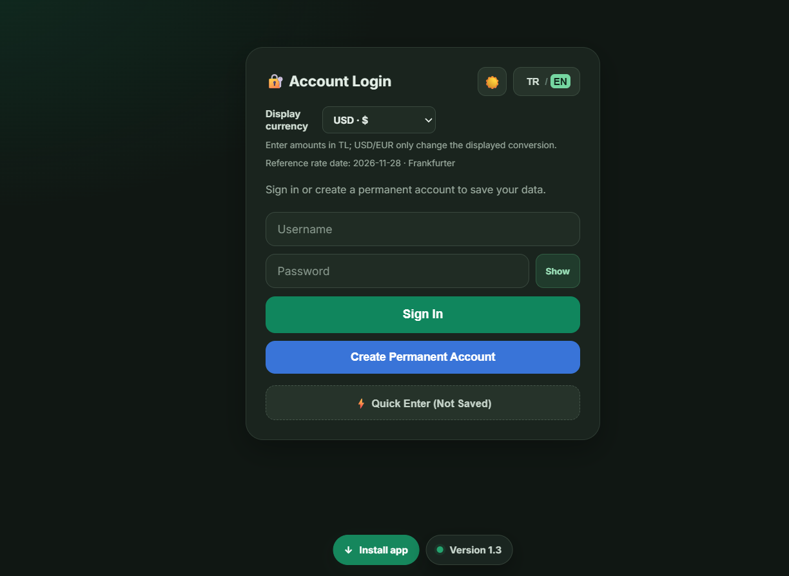
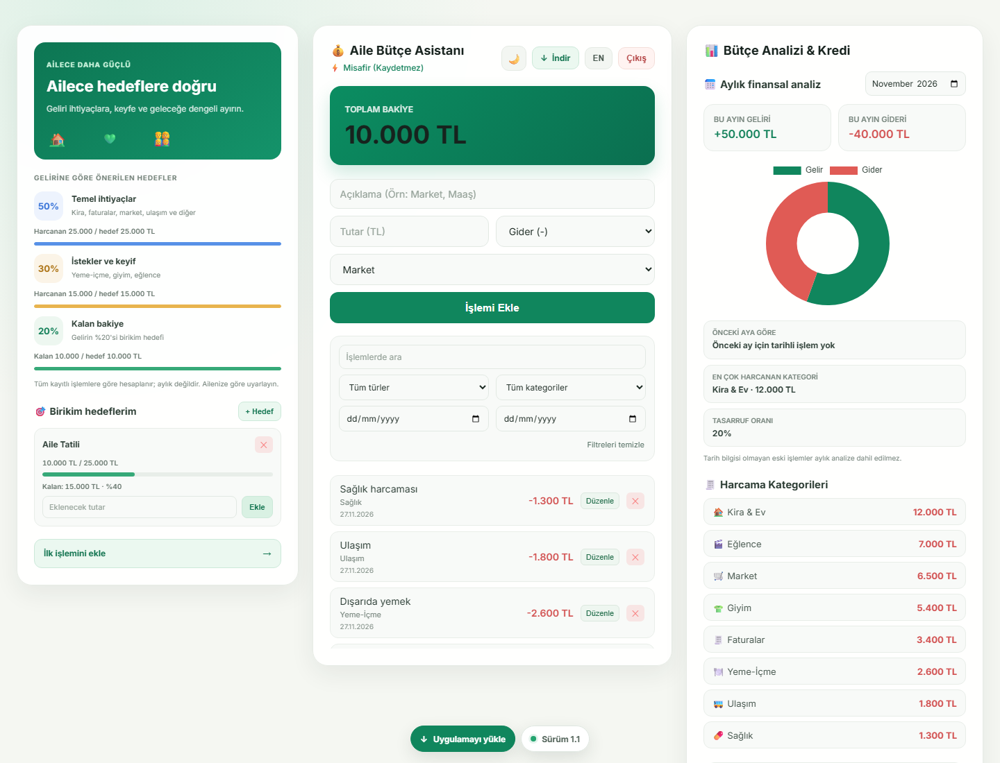

# Family Budget Assistant

[](LICENSE)
[](https://github.com/eneshtml76/family-budget-assistant/tree/v1.3)
[](https://eneshtml76.github.io/family-budget-assistant/)


A responsive, bilingual family budgeting application for tracking income, expenses, monthly trends, and savings goals. The web app can be installed from supported mobile and desktop browsers as a Progressive Web App (PWA).

**Live application:** [eneshtml76.github.io/family-budget-assistant](https://eneshtml76.github.io/family-budget-assistant/)

> **Current release: v1.3.** Install the app from a supported browser; a separate App Store or Google Play download is not currently provided. Offline support caches the application shell only. Account, transaction, and savings-goal features require an internet connection.

## Screenshots

<p align="center">
  
  
</p>

The dashboard screenshot uses illustrative guest-mode data; no real user data is shown.

## Features

- **Monthly financial overview:** See income, expenses, savings rate, top spending category, and comparison with the previous month.
- **Transaction management:** Add, edit, search, filter, and export transactions as CSV.
- **Transaction dates:** Choose or edit transaction dates for accurate date filtering and monthly analysis.
- **Spending categories:** Organize income and expenses with category totals.
- **Monthly category reports:** Compare category spending in the selected month with the previous month.
- **Savings goals:** Set a target, add contributions, and track progress and remaining amounts.
- **JSON backup and restore:** Download transaction and savings-goal backups, then restore them to guest mode or a registered account. Restoring replaces the current data; account restores require the account password. Backup files contain financial data and should be stored securely.
- **50/30/20 budget guide:** Compare recorded spending with suggested needs, wants, and savings allocations.
- **Loan simulator:** Estimate monthly payments, total repayment, and interest.
- **Optional currency display:** Keep TRY as the default or view amounts in USD/EUR using dated reference exchange rates. Saved amounts remain in TRY; online rates are required for conversion.
- **Installable PWA:** Install from supported Android and desktop browsers, or add the site to the iOS/iPadOS Home Screen.
- **Responsive interface:** Layouts adapt to desktop, tablet, and phone screens.
- **Light and dark themes:** The selected theme is remembered in the browser.
- **Turkish and English:** Switch languages from the sign-in screen or dashboard.

## Install the app

The site must be opened over HTTPS to install or use its service worker. GitHub Pages serves the live site over HTTPS.

- **Android:** Open the site in a supported browser such as Chrome and choose **Install app** or **Add to Home screen**.
- **Windows/macOS/Linux:** Open the site in a supported desktop browser and choose **Install app** from the app button or browser menu.
- **iPhone/iPad:** Open the site in Safari, tap **Share**, then choose **Add to Home Screen**.

The install action may not be offered by every browser. Use the instructions above if the in-page install prompt is unavailable. The app shell can open after it has been cached, but signing in and synchronizing financial data still require a network connection.

## Back up and restore data

Open the dashboard and select **Download backup** to save transactions and savings goals as a JSON file. To restore, select **Restore backup**, choose a JSON backup, review the replacement warning, then confirm. Registered accounts must provide their account password; restoration replaces the account's existing transactions and savings goals in one database transaction. Guest-mode data can also be restored, but remains temporary and is lost when the guest session ends.

Backup files contain financial data and are not encrypted. Store them somewhere private and secure.

## Releases and roadmap

### v1.3 — Reports and data backup

- Added monthly category reports comparing selected-month spending with the previous month.
- Added optional USD/EUR display conversion while keeping stored amounts in TRY.
- Added JSON backups for transactions and savings goals, with validated and confirmed restoration.
- Added an atomic account restore endpoint that verifies the account password before replacing records.
- Added optional USD/EUR display conversion while keeping stored amounts in TRY.

### v1.2 — Easier everyday use

- Added selectable transaction dates when creating and editing transactions.
- Added inline sign-in and registration feedback, password visibility controls, and Enter-key submission.
- Improved keyboard focus visibility and form accessibility on mobile and desktop.

### v1.1 — Installable web app

- Added a web app manifest, app icon, and service worker for install support and cached app-shell loading.
- Added browser installation controls and mobile/desktop installation instructions.
- Added an in-app release history and a versioned product roadmap.

### v1.0 — Budget management foundation

- Added monthly analytics, transaction editing and filtering, and CSV export.
- Added savings goals, dark mode, and responsive dashboard layouts.

### Planned milestones

Roadmap items are targets, not release commitments; scope may change based on testing and user feedback.

| Version | Planned focus |
| --- | --- |
| **v2.0** | Target final major release: a thoroughly tested, dependable experience for everyday use |

v2.0 is the planned final **major** version, not a promise that development will stop. Bug fixes, compatibility work, and security updates may continue afterward.

## Technology

- **Frontend:** HTML, CSS, and vanilla JavaScript modules
- **Charts:** Chart.js
- **Backend:** ASP.NET Core Web API
- **Database:** SQLite with Entity Framework Core
- **Hosting:** GitHub Pages (frontend) and Railway (API)

## Project structure

```text
frontend/
  css/                 # Ordered visual layers and responsive styles
  js/
    core/              # Shared DOM references, state, categories, and formatting
    features/          # Authentication, transactions, reports, backups, goals, charts
    services/          # API communication
    ui/                # Language, theme, and install/version interactions
    app.js             # Application entry point
  index.html
  service-worker.js
backend/BudgetApi/
  Controllers/         # HTTP endpoints
  Data/                # Entity Framework database context
  Models/              # Persistent data entities
  Security/            # Password hashing for sign-in and protected backup restore
  Program.cs            # API startup and dependency configuration
```

The frontend uses native browser modules and remains a static GitHub Pages site; no build step or bundler is required. Stylesheets load in the order listed by `frontend/index.html`, and the service worker precaches the application shell for offline launch.

## Run locally

### 1. Start the API

```powershell
cd backend\BudgetApi
dotnet run
```

The frontend's local API configuration expects the API at `http://localhost:5098`. If your local API uses another port, update `frontend/js/services/api.js` or configure the local launch URL accordingly. The API creates its SQLite database automatically. Set `BUDGET_DB_PATH` to choose a different database file.

### 2. Serve the frontend

From the repository root, run:

```powershell
python -m http.server 8080 --directory frontend
```

Open [http://localhost:8080](http://localhost:8080). `localhost` is treated as a secure context by modern browsers, so the service worker can be tested locally.

## Data and privacy

Registered account data is handled by the configured API and its SQLite database. Guest-mode data is temporary and is not synchronized. JSON backup files contain financial data; store them somewhere private and secure. Older transactions that predate transaction dates remain visible, but are excluded from date-based reports and filters because their original dates are unknown.

This project is a personal budgeting tool, not a bank or a regulated financial service. Do not enter bank credentials or use it as a substitute for professional financial advice.

## License

Distributed under the MIT License. See [LICENSE](LICENSE).
